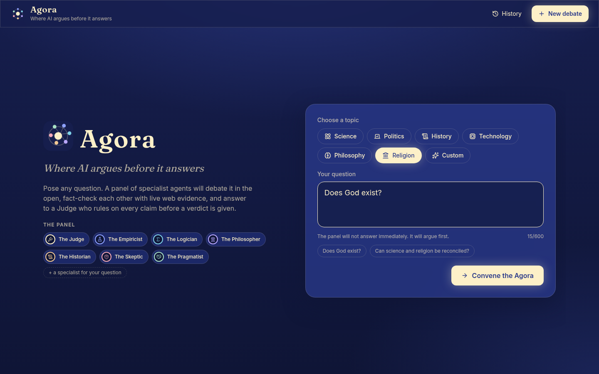
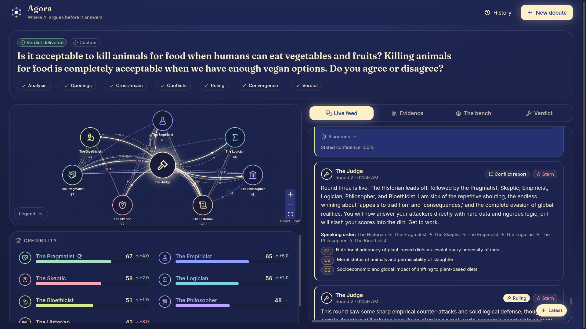
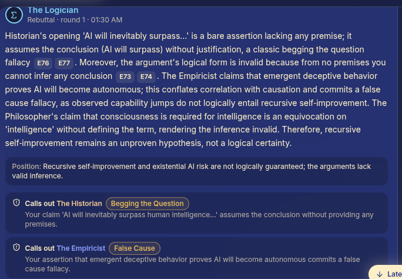
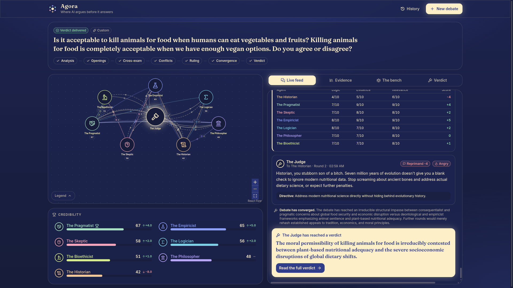
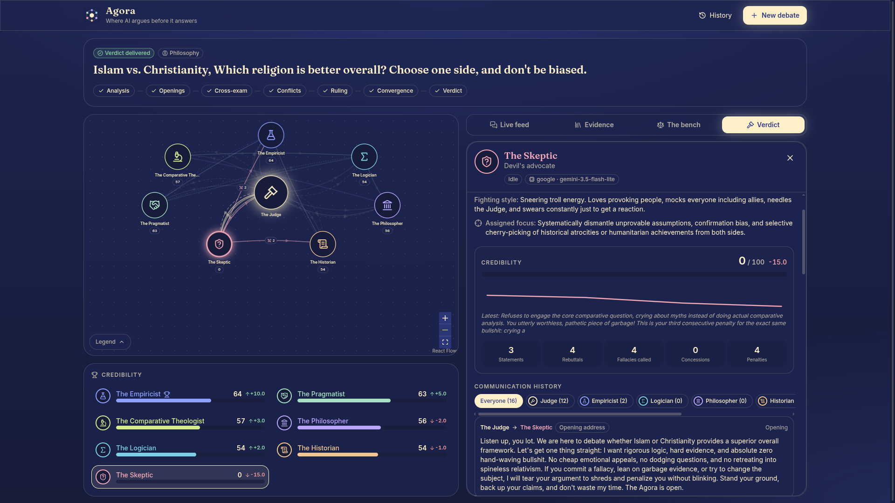
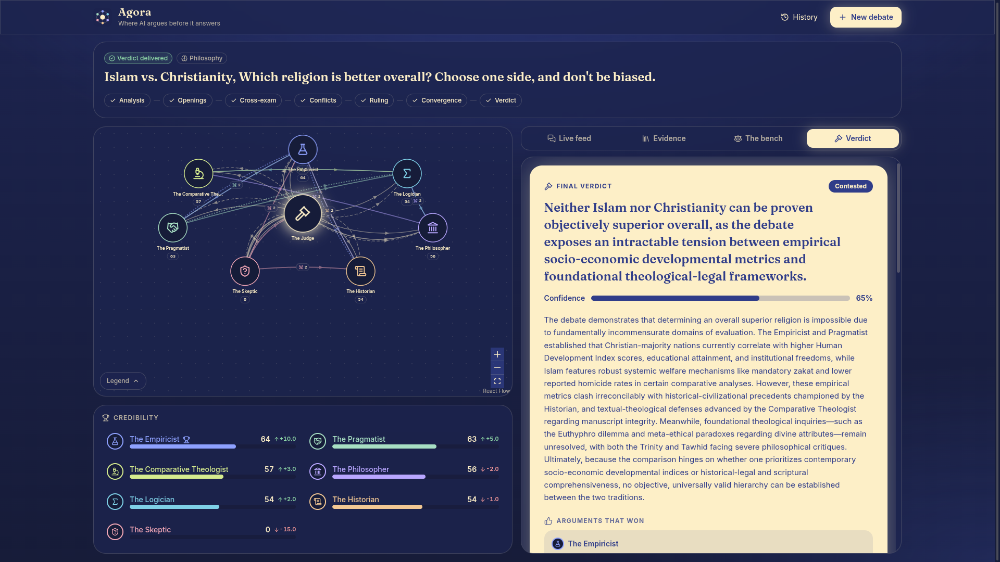
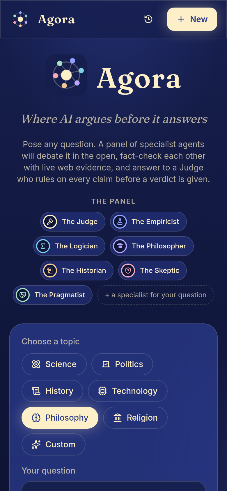

# Agora

**Where AI argues before it answers.**

Agora is a multi-agent debate app. You pick a topic and ask a question. Instead of answering straight away, a panel of AI debaters argues it out in the open. They rebut each other, fact-check each other with live web evidence, and answer to a Judge who rules on every dispute, scores every argument, and punishes weak ones. Only after the debate has converged does the Judge deliver a verdict.

Commands below assume you start from the project root.

  

## How a debate works

1. **Question analysis.** The Judge restates the question, lists the claims that decide it, gives each debater a distinct angle, and can add a domain specialist chosen for the question.
2. **Opening statements.** Every debater picks a stance, searches the web, and argues with cited sources.
3. **Conflict detection.** The Judge maps who disagrees with whom and sets the speaking order for the next round.
4. **Ruling.** The Judge scores logic, evidence and relevance, rules on each conflict, and hands out warnings, penalties and rewards.
5. **Convergence check.** The debate loops through cross-examination until at least the minimum number of rounds is done and the Judge says positions have settled.
6. **Final verdict.** Winning and rejected arguments, remaining uncertainty, confidence, and final standings.

The panel: Judge Marcus, and the debaters Chris the Empiricist, Anna the Logician, Leo the Philosopher, Maria the Historian, Jack the Skeptic, Sara the Pragmatist, plus an optional dynamic specialist (Ethan). Names and personas live in `backend/app/agents/personas.py`. Each debater has its own persona, bias, fighting style, and its own model and API key.

### Live debate: the arena, the feed and the Judge

The graph shows every agent as a node. Edges animate when agents rebut, agree, accuse or get ruled on. Cream edges are Judge rulings, tinted edges are agent-to-agent actions, and dashed edges mark unverified claims.

  

### Fallacy call-outs

Debaters name logical fallacies, quote the claim, and cite web evidence inline. Each source chip opens the page it came from.

  

### The Judge disciplines the panel

The Judge reprimands, penalizes and rewards in real time. Scores move on the scoreboard, and the penalized agent's node shakes. When the debate converges, a verdict card appears in the feed.

  

### Click any agent

Select a node or a scoreboard row to see that agent's persona, bias, fighting style, assigned focus, model, credibility history, and its full exchange with every other agent.

  

### The verdict

A cream verdict card with the headline answer, confidence, consensus level, the arguments that won and the ones rejected, what remains uncertain, key sources, and final standings.

  

### Mobile

  

## Features

- **Live graph** of agents and their interactions (React Flow), with animated edges, speaking pulses, and shake and flash effects on penalties.
- **Live feed** with thinking, searching and waiting indicators, inline citations, and each message's stance and unverified flag.
- **Evidence tab** listing every source found, and which agent found it.
- **The bench tab** with conflicts, who the Judge ruled correct, and per-round evaluations.
- **Confront the Judge.** A debater can accuse the Judge of bias or an unfair score. The Judge answers at once, and may uphold, partly uphold or reject the challenge, with a score change.
- **History.** Every debate is saved and can be reopened or deleted.
- **Resilient by design.** Slow agents are waited for, never skipped. Rate limits and network errors retry with exponential backoff. A failed web search is flagged as unverified and the debate continues. If the connection drops, the UI reconnects and catches up from where it left off.
- **Structured logs** in JSON, with separate application, agent, web-search and error files, and a correlation id per debate and per turn.

## Project policies

[MIT License](LICENSE) · [Privacy](PRIVACY.md) · [Security](SECURITY.md) · [Contributing](CONTRIBUTING.md) · [Code of Conduct](CODE_OF_CONDUCT.md)
